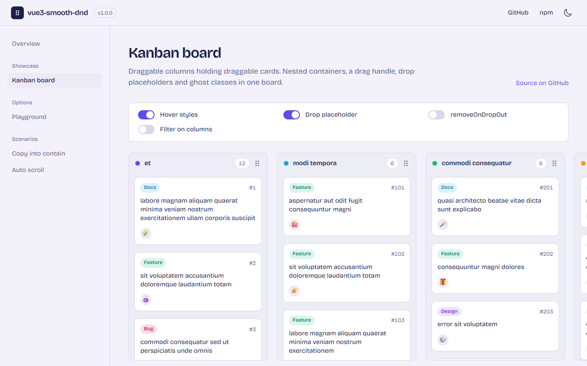

<h1 align="center">vue3-smooth-dnd</h1>

<p align="center">
  Drag &amp; drop / sortable components for Vue 3, built on <a href="https://github.com/kutlugsahin/smooth-dnd">smooth-dnd</a>.
  <br/>
  <a href="https://g1lg1l.github.io/vue3-smooth-dnd" target="_blank"><b>Live demo</b></a>
</p>

<p align="center">
  <a href="https://www.npmjs.com/package/vue3-smooth-dnd"></a>
  <a href="https://github.com/g1lg1l/vue3-smooth-dnd/actions/workflows/ci.yml"></a>
  <a href="./LICENSE"></a>
</p>

- Two components, `<Container>` and `<Draggable>`, that render your own markup
- Sortable lists, kanban boards (nested containers), copy / move / contain / drop-zone behaviours
- Smooth CSS-transition animations, drop placeholder, drag handles, auto scroll (elements **and** the window)
- TypeScript types included, zero runtime dependencies (smooth-dnd is bundled and maintained here, see [Credits](#credits))



## Install

```bash
npm install vue3-smooth-dnd
```

Requires Vue `^3.3` (the type declarations are generated against Vue 3.5).

## Usage

```vue
<script setup lang="ts">
import { ref } from 'vue'
import { Container, Draggable, type DropResult } from 'vue3-smooth-dnd'

const items = ref([
  { id: 1, title: 'Princess Mononoke' },
  { id: 2, title: 'Spirited Away' },
  { id: 3, title: 'My Neighbor Totoro' },
])

function onDrop({ removedIndex, addedIndex, payload }: DropResult) {
  if (removedIndex === null && addedIndex === null) return
  const result = [...items.value]
  const item = removedIndex !== null ? result.splice(removedIndex, 1)[0] : payload
  if (addedIndex !== null) result.splice(addedIndex, 0, item)
  items.value = result
}
</script>

<template>
  <Container @drop="onDrop">
    <Draggable v-for="item in items" :key="item.id">
      <div class="card">{{ item.title }}</div>
    </Draggable>
  </Container>
</template>
```

`<Container>` never touches your DOM on drop: it emits `drop` and you update your data, Vue re-renders.

### Moving items between containers

Give the containers the same `group-name`. Every container involved emits `drop`: the source with a `removedIndex`, the target with an `addedIndex`. Use `get-child-payload` so the target knows what was dropped:

```vue
<Container
  v-for="column in columns"
  :key="column.id"
  group-name="cards"
  :get-child-payload="(index) => column.items[index]"
  @drop="onDrop(column, $event)"
>
```

The [Kanban demo](./demo/src/demos/Kanban.vue) shows nested containers (draggable columns holding draggable cards), `should-accept-drop`, drop placeholders and ghost classes.

## `<Container>`

### Props

| Prop                     | Type                                                        | Default              | Description                                                                                                                                            |
| ------------------------ | ----------------------------------------------------------- | -------------------- | ------------------------------------------------------------------------------------------------------------------------------------------------------ |
| `orientation`            | `'vertical' \| 'horizontal'`                                | `'vertical'`         | Layout direction. Read once at mount; re-key the component to change it.                                                                               |
| `behaviour`              | `'move' \| 'copy' \| 'drop-zone' \| 'contain'`              | `'move'`             | `copy` leaves the item in place, `drop-zone` accepts drops without sorting (`addedIndex` is always 0), `contain` keeps the ghost inside the container. |
| `group-name`             | `string`                                                    | –                    | Items can move between containers sharing a group name. Overridden by `should-accept-drop`.                                                            |
| `lock-axis`              | `'x' \| 'y'`                                                | –                    | Restrict the ghost movement to one axis.                                                                                                               |
| `drag-handle-selector`   | `string`                                                    | –                    | CSS selector; a drag starts only from a matching element inside the draggable.                                                                         |
| `non-drag-area-selector` | `string`                                                    | –                    | CSS selector; matching elements (buttons, inputs…) never start a drag. Wins over `drag-handle-selector`.                                               |
| `drag-begin-delay`       | `number`                                                    | `0` (`200` on touch) | Milliseconds to hold before the drag starts. Moving more than 5px during the delay cancels it.                                                         |
| `animation-duration`     | `number`                                                    | `250`                | Duration of reorder and drop animations in ms.                                                                                                         |
| `auto-scroll-enabled`    | `boolean`                                                   | `true`               | Auto scroll scrollable ancestors and the window when the pointer is within 100px of an edge.                                                           |
| `remove-on-drop-out`     | `boolean`                                                   | `false`              | When dropped outside every relevant container, emit `drop` with a `removedIndex` instead of animating back.                                            |
| `drag-class`             | `string`                                                    | –                    | Class added to the ghost's element while dragging (added after mount so transitions run).                                                              |
| `drop-class`             | `string`                                                    | –                    | Class added to the ghost's element when the drop animation starts.                                                                                     |
| `drop-placeholder`       | `boolean \| { className?, animationDuration?, showOnTop? }` | –                    | Show a placeholder where the item would land.                                                                                                          |
| `get-child-payload`      | `(index: number) => any`                                    | –                    | Returns the `payload` passed to every event for the item at `index`.                                                                                   |
| `should-accept-drop`     | `(sourceOptions, payload) => boolean`                       | –                    | Decides, at drag start, whether this container accepts the dragged item.                                                                               |
| `should-animate-drop`    | `(sourceOptions, payload) => boolean`                       | –                    | Return `false` to skip the drop animation.                                                                                                             |
| `get-ghost-parent`       | `() => HTMLElement`                                         | –                    | Element the ghost is appended to. See [Ghost](#ghost-position-and-transformed-parents).                                                                |
| `tag`                    | `string \| Component \| { value, props }`                   | `'div'`              | Root element. Attributes and classes on `<Container>` fall through to it.                                                                              |

All props except `orientation` are reactive: changing them updates the running container.

### Events

| Event        | Payload                                          | Emitted by                                                                                                       |
| ------------ | ------------------------------------------------ | ---------------------------------------------------------------------------------------------------------------- |
| `drop`       | `{ removedIndex, addedIndex, payload, element }` | The source container and the target container, after the drop animation. Indices are `null` when not applicable. |
| `drop-ready` | `{ removedIndex, addedIndex, payload, element }` | The container being hovered, every time the would-be drop index changes.                                         |
| `drag-start` | `{ isSource, payload, willAcceptDrop }`          | Every container when a drag starts.                                                                              |
| `drag-end`   | `{ isSource, payload, willAcceptDrop }`          | Every container when a drag ends, right before `drop`.                                                           |
| `drag-enter` | –                                                | A container when the ghost enters it.                                                                            |
| `drag-leave` | –                                                | A container when the ghost leaves it.                                                                            |

## `<Draggable>`

Wraps one item. It renders a `div` (or `tag`) with the class `smooth-dnd-draggable-wrapper`; attributes and classes fall through. Keep margins on your inner element rather than on the `<Draggable>` itself: the drag ghost is a clone of the wrapper.

```vue
<Draggable tag="li" class="row">…</Draggable>
```

## Globals

```ts
import { smoothDnD } from 'vue3-smooth-dnd'

smoothDnD.isDragging() // boolean
smoothDnD.cancelDrag() // abort the current drag, everything animates back
smoothDnD.maxScrollSpeed = 1500 // px/s used by auto scroll
smoothDnD.useTransformForGhost = true // move the ghost with translate3d instead of top/left
```

## Styling notes

- A `<style>` block with the required layout rules is injected once. The classes you may want to target: `smooth-dnd-container`, `smooth-dnd-draggable-wrapper`, `smooth-dnd-ghost`.
- The injected rules are unlayered: `position: relative; min-height: 30px; min-width: 30px` on containers, `display: table` on horizontal ones, `display: block; overflow: hidden` on wrappers in vertical ones. With cascade layers (Tailwind 4 puts utilities in `@layer utilities`) an unlayered rule always wins, so `flex` or `min-h-64` on a `<Container>` have no effect there. Use the important modifier (`flex!`, `min-h-64!`), an inline style, or an unlayered rule of your own.
- While a drag is running `<body>` has the class `smooth-dnd-dragging`, and draggables get `pointer-events: none` so `:hover` styles don't fire on the items under the ghost. To restore hover during drags: `.smooth-dnd-dragging .smooth-dnd-draggable-wrapper { pointer-events: auto }`.
- Add `smooth-dnd-prevent-auto-scroll-class` to a scrollable element (or to `<html>` / `<body>` for the window) to exclude it from auto scroll.

### Ghost position and transformed parents

The ghost is `position: fixed` and appended to the container. An ancestor with `transform`, `filter`, `perspective` or `contain` becomes its containing block and would offset it, so in that case the ghost is automatically re-parented to `<body>`. If you need a different parent (for example to keep inherited styles or CSS variables), pass `get-ghost-parent`.

## Migrating from 0.x

- `smooth-dnd` is no longer a dependency; it is bundled. `smoothDnD`, `constants`, `dropHandlers` and all types are still exported from `vue3-smooth-dnd`.
- Props you don't set no longer override smooth-dnd's defaults (a `<Container>` without `behaviour` used to lose its drop-out animation, without `animation-duration` its animations, without `orientation` its layout class).
- Props are reactive now (except `orientation`).
- ESM (`import`), CommonJS (`require`) and a UMD build (`unpkg` / `jsdelivr`, global `Vue3SmoothDnD`) are published, plus TypeScript declarations.
- Node 20.19+ / modern browsers only; the IE polyfills were dropped.

## Development

The repository is the package itself plus a `demo` workspace (npm workspaces, Node 22).

| Path             | What                                                                 |
| ---------------- | -------------------------------------------------------------------- |
| `src/components` | The two Vue components                                               |
| `src/smooth-dnd` | The bundled smooth-dnd core, fixes marked `// vue3-smooth-dnd:`      |
| `demo`           | The demo site, deployed to GitHub Pages. Runs against `src` with HMR |
| `e2e`            | Playwright tests driving the demo, one per reported issue            |

```bash
npm install
npm run dev          # demo on http://localhost:5173/
npm run lint         # eslint
npm run format       # prettier
npm run typecheck    # tsc
npm test             # playwright (uses your Chrome; run `npx playwright install chromium` otherwise)
npm run build        # → dist (esm, cjs, umd, .d.ts)
npm run build:demo   # → demo/dist
```

### Releasing

First-time setup:

- Repository settings → Pages → Source: **GitHub Actions**. From then on every push to `main` runs the `Deploy demo` workflow and publishes `demo/dist` to https://g1lg1l.github.io/vue3-smooth-dnd/.
- On npmjs.com, package Settings → Trusted Publisher → GitHub Actions: user `g1lg1l`, repository `vue3-smooth-dnd`, workflow `release.yml`, allowed action `npm publish`. No token or secret is needed. A new trusted publisher expires unless it publishes within 2 days.

Every release:

1. `npm version <patch|minor|major>` bumps `package.json`, commits and tags (for example `v1.0.1`).
2. Describe the changes in `CHANGELOG.md`, commit, then `git push --follow-tags`.
3. On GitHub, draft a release for that tag and publish it. The `Release` workflow runs the type check and `npm publish`, with provenance.

Without the workflow: `npm login` once, then `npm publish` from the repository root. `prepublishOnly` builds first.

## Credits

This package started as a Vue 3 port of [vue-smooth-dnd](https://github.com/kutlugsahin/vue-smooth-dnd). Both it and the bundled core, [smooth-dnd](https://github.com/kutlugsahin/smooth-dnd), were written by Kutlu Sahin (MIT). smooth-dnd is unmaintained upstream, so its source lives in this repository under `src/smooth-dnd` with bug fixes on top.

## License

[MIT](./LICENSE)
